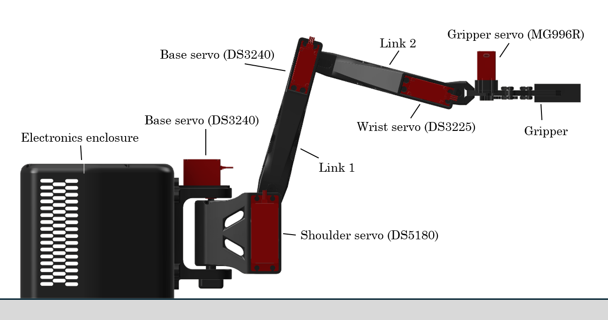

# WDD2 pick-and-place arm

A low-cost, four-joint pick-and-place arm built for Mechatronic Project 478 at Stellenbosch University (2026). Hobby servos drive the joints, an AS5600 magnetic encoder on each joint closes the position loop, and the gripper detects a grasp from its servo current instead of a force sensor.

&#x20;    

&#x20;  

## Results

|Measure|Result|
|-|-|
|Positioning accuracy (ISO 9283)|3.1 to 6.4 mm, limit 10 mm|
|Pick-and-place cycles, 50 g and 500 g|25 of 25, about 12 s each|
|Grasp detection|70 of 70 trials|
|Encoder accuracy|within 0.61° of reference|
|Joint loop|200 Hz, no overruns|
|Parts cost|R4 447|

## Repository

|Folder|Contents|
|-|-|
|`firmware/`|ESP32-S3 firmware (hand-in version v2.5 and earlier test versions)|
|`software/`|Python GUI, simulator and inverse kinematics|
|`cad/`|Fusion 360 assembly, STL files and URDF|
|`electronics/`|KiCad schematics and bill of materials|
|`analysis/`|Servo sizing, bearing life and the scripts that made the report figures|
|`test-data/`|Bring-up and test data, 9 to 20 October 2026|
|`docs/`|Report, proposal, datasheet links and notes for future students|

## Quick start

1. Print the parts in `cad/stl/` (PLA-CF at 100 % infill for the arm, PETG at 60 % for the housing, TPU 95A for the jaw pads).
2. Wire the electronics as in `electronics/`, and set the three buck converters to 8.0 V, 6.7 V and 6.5 V before connecting any servo.
3. Flash `firmware/WDD2\\\_firmware/WDD2\\\_firmware.ino` to the ESP32-S3 (see `firmware/README.md`).
4. Install the Python packages and run the GUI (see `software/`).

## Hardware

ESP32-S3 N16R8 · DS5180 (shoulder), 2 × DS3240 (base, elbow), DS3225 (wrist), MG996R (gripper) · 4 × AS5600 through a TCA9548A · INA219 · 12 V 20 A supply, three XL4016 converters, latching emergency stop with relay.

## Credits

Nathan Spalding, supervised by Dr W. Duckitt, Department of Mechanical and Mechatronic Engineering, Stellenbosch University, 2026.

